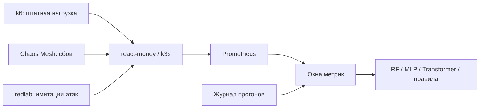
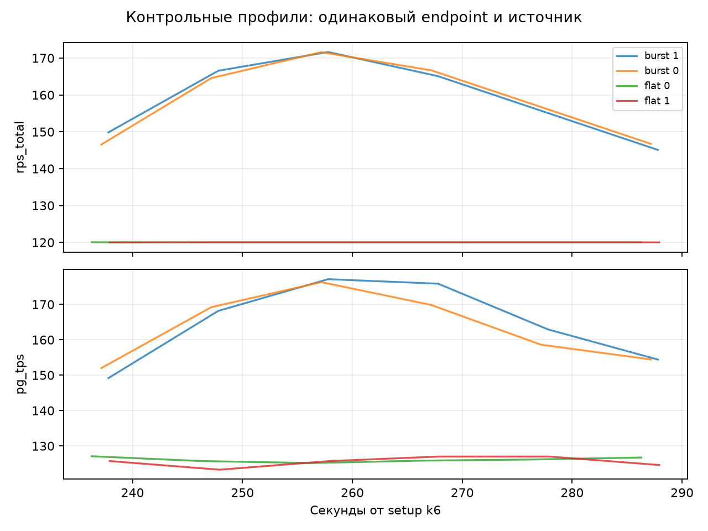

# Обнаружение атак и сбоев микросервисного приложения в Kubernetes по метрикам мониторинга

**Черновик для обсуждения с научным руководителем, 13 ноября 2026 г.** Приведённые количественные результаты относятся к предварительной обработке исторического набора и не являются окончательными для публикации: временные метки отдельных отсчётов и подтверждение успешной инъекции отсутствуют.

## Аннотация

Исследуется возможность различения нормальной работы, штатных сбоев и имитаций атак на приложение в Kubernetes по метрикам мониторинга. На изолированном стенде собраны сценарии фоновой нагрузки, отказов и атак. Сравниваются Random Forest, многослойный перцептрон, Transformer и простая модель пороговых правил; испытания разделяются по прогонам. Отдельно рассматриваются похожие сценарии и перенос на невиданные сценарии и семейства атак. Аудит исторического набора выявил существенные ограничения разметки и временного контекста; поэтому результаты рассматриваются как поисковые. В частности, модель может успешно распознавать знакомые сценарии, но пропускать семейства атак, отсутствовавшие при обучении.

**Ключевые слова:** Kubernetes, мониторинг, обнаружение вторжений, машинное обучение, отказоустойчивость, Random Forest, Transformer.

## 1. Введение и обзор

Рост интенсивности запросов, доли ошибок или задержки сам по себе не устанавливает причину отклонения: похожие изменения могут сопровождать как сбой, так и целенаправленную нагрузку. Ошибка в сторону атаки увеличивает число ложных обращений к специалистам по ИБ, а ошибочное отнесение атаки к сбою задерживает расследование. Цель работы — изучить, насколько классификаторы по собранным метрикам различают предусмотренные сценарии, и измерить границы переноса на сценарии, отсутствовавшие при обучении.

Существующие работы исследуют мониторинг микросервисов по разным источникам. В LO2 собраны метрики и логи корректных и ошибочных API-вызовов [1]; AnoMod сочетает пять модальностей и несколько категорий отказов [2]; ServiceAnomaly использует распределённые трассы и профилирующие метрики [3]. Наличие смежных работ не позволяет считать саму классификацию аномалий или набор выбранных метрик уникальными. Позиционирование данного исследования — конкретный воспроизводимый стенд, сопоставление похожих сценариев и анализ переноса на исключённые из обучения семейства.

## 2. Стенд и данные

Приложение react-money развёрнуто в k3s; метрики собираются Prometheus. Генератор создаёт нагрузку k6, сбои Chaos Mesh и атакующие сценарии в выделенном namespace; журнал содержит интервалы прогонов. Данные отражают один узел и одно приложение, а не произвольную промышленную микросервисную систему.

В историческом наборе зафиксированы 119 завершившихся прогонов, 4243 окна и 21 серия. Один из запланированных SQLi-прогонов не состоялся: фон не достиг порога до тайм-аута. Доли исходных окон: норма 2232, сбой 948, атака 1063. Важные пары — всплеск ошибочных ответов 401 из-за невалидных токенов и перебор паролей; высокий поток штатных запросов и флуд. Эти пары имеют конфаундеры: флуд обращается к `/health`, а штатная нагрузка — к API, использующему БД.

| № | Метка | Сценарий и инструмент | Заданные параметры |
|---|---|---|---|
| 00 | норма | базовая нагрузка, k6 | 80–120 запросов/с; 300–480 с |
| 01 | норма | flash-crowd, k6 | 700–1600 запросов/с; 300–480 с |
| 10 | сбой | задержка backend → БД, NetworkChaos | 100–400 мс; 180–360 с |
| 11 | сбой | удаление pod backend, PodChaos | разовое действие; наблюдение 180–300 с |
| 12 | сбой | CPU stress, StressChaos | 1–2 worker; 70–100%; 180–360 с |
| 14 | сбой | невалидный JWT, k6 | задано 300 запросов/с, скрипт 120 с |
| 20 | атака | имитация перебора, curl | длительность по заданному deadline; rate не зафиксирован |
| 21 | атака | флуд `/health`, k6 | задано 1000–5000 запросов/с |
| 22 | атака | SQLi-скан, sqlmap | длительность по заданному deadline; rate не зафиксирован |
| 23 | атака | медленный перебор, k6 | задано 5–25 запросов/с |
| 24 | атака | сканирование путей, k6 | задано 30–70 запросов/с |
| 25 | атака | слабый флуд, k6 | задано 150–500 запросов/с |

Таблица отражает диапазоны настроек генератора, а не подтверждённую фактическую интенсивность каждого прогона. Исторические Job не имеют независимого подтверждения начала и успешности воздействия.

Аудит исключает окна с неподтверждённой полнотой 180-секундной истории, восстановления и сценарий единичного удаления pod с неподтверждённой длительностью сбоя. Осталось 1556 окон: 372 нормы, 509 сбоев и 675 атак. Поскольку baseline в сценариях сбоев и атак длился 120 секунд, отобранные нормальные окна остались только из самостоятельных нормальных сценариев; это может облегчать классификацию по особенностям прогона. Результирующее распределение представляет исследовательскую фильтрацию, а не частоты инцидентов в эксплуатации. Полное описание и контрольные суммы приведены в [аудите](AUDIT_2026-11-13.md).

## 3. Методика

Все модели получают один и тот же набор окон и историю из 18 отсчётов с предполагаемым шагом 10 секунд. Табличные модели используют агрегаты и долю пропусков каждой серии; Transformer — последовательность и маску пропусков. В архивных файлах отсутствуют timestamps отсчётов, поэтому точная временная причинность истории не проверяется независимо; допускается, что исторический экспорт соблюдал заявленные параметры. В основной предварительной таблице не учтён дополнительный одноминутный интервал `rate()` Prometheus: поэтому первые показатели истории могут частично включать предыдущий интервал. Более строгий фильтр с этим запасом оставляет 913 окон и полностью исключает исторический authfail; он должен рассматриваться отдельно. Значения для заполнения и нормализации вычисляются только на обучающих данных.

Прогоны разделяются на train, validation и test по сценариям. Обучающие прогоны отбираются вложенными долями 50%, 75% и 100%. Используются пять групповых разбиений и три seed инициализации, а также отдельный тест на последних прогонах. MLP обучается с отключённым случайным early stopping; Transformer выбирает эпоху по validation с независимыми прогонами. Baseline — дерево глубины два, обучающее пороги RPS, процента ошибок и транзакций БД.

Основная метрика — Macro-F1. Дополнительно анализируются матрицы ошибок, доли `сбой → атака`, `норма → атака`, `атака → сбой` и recall атаки. Для переноса из обучения исключаются сначала отдельные сценарии, затем родственные семейства: brute/low-brute и flood/low-flood. Один и тот же прогон может попадать в тест нескольких независимых разбиений; окна и повторные seed не являются независимыми испытаниями.

## 4. Предварительные результаты

На подготовленной исторической выборке среднее Macro-F1 по пяти групповым разбиениям (сначала среднее по трём seed внутри каждого разбиения):

| Метод | 50% train | 75% train | 100% train |
|---|---:|---:|---:|
| Пороговые правила | 0.625 | 0.576 | 0.587 |
| Random Forest | 0.987 | 0.984 | 0.998 |
| MLP | 0.905 | 0.934 | 0.982 |
| Transformer | 0.945 | 0.936 | 0.981 |

Стандартные отклонения по разбиениям и протокол построения доступны в `ml/audited_results/macro_f1_by_split.csv`. Для части запусков MLP достиг установленного лимита итераций без сходимости; это ограничивает интерпретацию сравнения и требует настройки на независимой validation. Высокие результаты для знакомых сценариев не доказывают распознавание намерения атакующего: модели могут использовать различия сценариев, адресов приложения и рабочего окружения.

Кривые обучения и матрицы ошибок приведены в [предварительном отчёте](ml/AUDITED_RESULTS.md). Отчёт также содержит ошибки для похожих сценариев, абляции метрик и параметры временного теста.

При строгом учёте минутного lookback на другой, более узкой выборке средний Macro-F1 на 100% train составил RF 0.950 ± 0.101, MLP 0.968 ± 0.040 и Transformer 0.919 ± 0.057 по пяти разбиениям. Из этой выборки полностью исчезает исторический authfail, поэтому сравнивать её с первой как идентичный тест нельзя. Полные значения — в [отдельном отчёте](ml/STRICT_RESULTS.md).

При исключении семейства brute из обучения RF распознал 0.498 окон как атаку (257 окон в тестовых частях пяти разбиений); при исключении семейства flood — 0.000 из 264 окон. Эти окна коррелированы и могут повторяться между разбиениями; числа характеризуют только данный эксперимент. Подробные предсказания по отдельным прогонам и сценариям приведены в `ml/audited_results/generalization_predictions.csv.gz`.

### Контроль одинакового endpoint

13 ноября дополнительно выполнены четыре ограниченных контрольных прогона: по два равномерных и переменных профиля к одному `/api/auth/me` от одного источника в `redlab`. Оба профиля — синтетическая тестовая нагрузка, не подтверждённая атака. У равномерного профиля задано 120 запросов/с; переменный плавно меняется между 60 и 180 запросами/с при той же средней заданной интенсивности. Все четыре Job успешно завершились, сырые ряды с timestamps и статусы сохранены; первые 235 секунд каждого прогона не оцениваются с учётом 180-секундной истории и 60-секундного lookback метрик `rate()`.

RF, дополнительно обученный на всей отфильтрованной исторической выборке без дополнительного lookback-фильтра, предсказал для двух переменных контролей класс «атака» в 12 из 12 анализируемых окон. Для двух равномерных контролей получено 8 окон «норма» и 4 «сбой» из 12; предсказаний «атака» не было. Окна внутри каждого пяти­минутного прогона перекрываются и не являются независимыми экспериментами. Имеются всего два повтора каждого профиля, порядок — flat/burst/burst/flat; между профилями не контролировалось полное восстановление HPA. Сбор контролей проводился через шесть недель после исторического набора, поэтому различие условий и временной дрейф также могут влиять на результат. Это проверка возможных ложных тревог на двух искусственных профилях, а не оценка общей частоты ложных срабатываний и не доказательство обнаружения атаки.

Дополнительно выполнено по три повтора с более короткими циклами переменного профиля (`matched-ramp30s-v2`), чтобы частоты в исследуемых окнах перекрывались с равномерным потоком. В контрольных окнах переменного профиля медиана RPS каждого прогона составила 120; исторический RF классифицировал 12 из 18 перекрывающихся окон как «атака», 6 — как «норма». Для трёх равномерных повторов 12 окон получили метку «норма», 6 — «сбой», ни одно — «атака». Четыре предыдущих прогона и шесть новых имеют разные профили и не должны объединяться как точные повторы. На рисунке показаны обе версии.

### Дополнительная пара одинаковых 401

Собраны по пять прогонов ошибки клиента и имитации перебора: 10 запросов/с к одному `/api/auth/login`, одному синтетическому адресу `.invalid`, с 401 как ожидаемым ответом. Пароли одинаковой длины: в сценарии ошибки повторяется одно неверное значение, при имитации перебора значения меняются. HTTP-тела не входят в метрики. Вместе с десятью контрольными прогонами нормальной нагрузки получено 120 окон по 180 секунд; timestamps вычислений Prometheus `query_range`, результаты PromQL и статусы успешных Job сохранены, перед каждым окном учтён 60-секундный lookback `rate()`. Сырые счётчики на каждый scrape не архивировались.

Дополнительно сохранены запросы без нулевой подстановки и значения `up` для четырёх экспортеров. На 120 оценочных точках все четыре экспортера имели `up=1`; в 24 точках ноль 401/403 подставлялся при отсутствии исходного ряда. Отсутствие ряда для кода ответа может означать, что запросов с этим кодом не было, поэтому оно не приравнивается автоматически к неисправности источника; `up=1` не гарантирует наличия каждого ряда. Диагностическая отметка отсутствующего ряда не включалась в признаки обученных моделей; их оценки не пересчитывались по результатам этой проверки.

На этой малой выборке при 100% обучающих прогонов средний Macro-F1 по пяти групповым разбиениям и трём seed составил: пороговые правила 0.556 ± 0.000, RF 0.491 ± 0.090, MLP 0.500 ± 0.171, Transformer 0.543 ± 0.017. Для RF доля `сбой → атака` составила 0.689, а `атака → сбой` — 0.667 при объединении окон по разбиениям и seed. Окна коррелированы, те же прогоны встречаются в нескольких разбиениях; эти доли описывают только данный синтетический контроль. Модели могут не иметь в агрегированных метриках информации о содержимом паролей и намерении клиента; ошибки не доказывают, что любое различение в реальной сети невозможно. Подробная методика, матрицы и предсказания: [отчёт проверенной серии](ml/VERIFIED_RESULTS.md).

## 5. Ограничения и заключение

Метки отражают интервалы оркестратора, но не содержат независимого подтверждения фактической инъекции; recovery было помечено как норма автоматически. У последовательностей нет временных меток, поэтому требуется новый сбор с сохранением сырых рядов и статусов сценариев. Для flood и штатного наплыва необходимо сравнение одинаковых endpoint с пересекающейся интенсивностью. Один стенд не позволяет установить переносимость на другие приложения, узлы и реальные атаки. Доля атак в датасете задана планом эксперимента и не отражает их частоту в эксплуатации.

На исследованных знакомых сценариях модели достигают высокого качества. Эксперимент исключения семейств демонстрирует, что перенос на невиданный тип может оказаться существенно хуже. Для окончательного вывода необходимо восполнить указанные пробелы и повторить оценку на подтверждённых данных.

## Список литературы

1. Bakhtin A. et al. LO2: Microservice API Anomaly Dataset of Logs and Metrics. 2025. https://arxiv.org/abs/2504.12067
2. Ping K. et al. AnoMod: A Dataset for Anomaly Detection and Root Cause Analysis in Microservice Systems. MSR 2026. https://arxiv.org/abs/2601.22881
3. Panahandeh M., Hamou-Lhadj A., Hamdaqa M., Miller J. ServiceAnomaly: An Anomaly Detection Approach in Microservices Using Distributed Traces and Profiling Metrics. https://users.encs.concordia.ca/~abdelw/papers/JSS24-ServiceAnomaly_preprint.pdf
