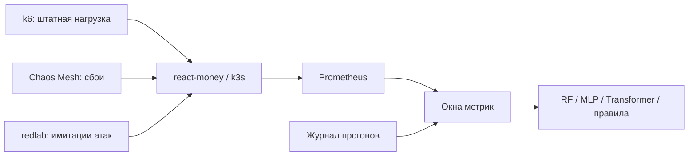

# Обнаружение атак и сбоев микросервисного приложения в Kubernetes по метрикам мониторинга

**Черновик для обсуждения с научным руководителем, 13 ноября 2026 г.** Приведённые количественные результаты относятся к предварительной обработке исторического набора и не являются окончательными для публикации: временные метки отдельных отсчётов и подтверждение успешной инъекции отсутствуют.

## Аннотация

Исследуется возможность различения нормальной работы, штатных сбоев и имитаций атак на приложение в Kubernetes по метрикам мониторинга. На изолированном стенде собраны сценарии фоновой нагрузки, отказов и атак. Сравниваются Random Forest, многослойный перцептрон, Transformer и простая модель пороговых правил; испытания разделяются по прогонам. Отдельно рассматриваются похожие сценарии и перенос на невиданные сценарии и семейства атак. Аудит исторического набора выявил существенные ограничения разметки и временного контекста; поэтому результаты рассматриваются как поисковые. В частности, модель может успешно распознавать знакомые сценарии, но пропускать семейства атак, отсутствовавшие при обучении.

**Ключевые слова:** Kubernetes, мониторинг, обнаружение вторжений, машинное обучение, отказоустойчивость, Random Forest, Transformer.

## 1. Введение и обзор

Рост интенсивности запросов, доли ошибок или задержки сам по себе не устанавливает причину отклонения: похожие изменения могут сопровождать как сбой, так и целенаправленную нагрузку. Ошибка в сторону атаки увеличивает число ложных обращений к специалистам по ИБ, а ошибочное отнесение атаки к сбою задерживает расследование. Цель работы — изучить, насколько классификаторы по собранным метрикам различают предусмотренные сценарии, и измерить границы переноса на сценарии, отсутствовавшие при обучении.

Существующие работы исследуют мониторинг микросервисов по разным источникам. В LO2 собраны метрики и логи корректных и ошибочных API-вызовов [1]; AnoMod сочетает пять модальностей и несколько категорий отказов [2]; ServiceAnomaly использует распределённые трассы и профилирующие метрики [3]. Наличие смежных работ не позволяет считать саму классификацию аномалий или набор выбранных метрик уникальными. Позиционирование данного исследования — конкретный воспроизводимый стенд, сопоставление похожих сценариев и анализ переноса на исключённые из обучения семейства.

## 2. Стенд и данные

Приложение react-money развёрнуто в k3s; метрики собираются Prometheus. Генератор создаёт нагрузку k6, сбои Chaos Mesh и атакующие сценарии в выделенном namespace; журнал содержит интервалы прогонов. Данные отражают один узел и одно приложение, а не произвольную промышленную микросервисную систему.

В историческом наборе зафиксированы 119 завершившихся прогонов, 4243 окна и 21 серия. Один из запланированных SQLi-прогонов не состоялся: фон не достиг порога до тайм-аута. Доли исходных окон: норма 2232, сбой 948, атака 1063. Важные пары — всплеск ошибочных ответов 401 из-за невалидных токенов и перебор паролей; высокий поток штатных запросов и флуд. Эти пары имеют конфаундеры: флуд обращается к `/health`, а штатная нагрузка — к API, использующему БД.

Аудит исключает окна с неподтверждённой полнотой 180-секундной истории, восстановления и сценарий единичного удаления pod с неподтверждённой длительностью сбоя. Осталось 1556 окон: 372 нормы, 509 сбоев и 675 атак. Результирующее распределение представляет исследовательскую фильтрацию, а не частоты инцидентов в эксплуатации. Полное описание и контрольные суммы приведены в [аудите](AUDIT_2026-11-13.md).

## 3. Методика

Все модели получают один и тот же набор окон и историю из 18 отсчётов с предполагаемым шагом 10 секунд. Табличные модели используют агрегаты и долю пропусков каждой серии; Transformer — последовательность и маску пропусков. В архивных файлах отсутствуют timestamps отсчётов, поэтому точная временная причинность истории не проверяется независимо; допускается, что исторический экспорт соблюдал заявленные параметры. Значения для заполнения и нормализации вычисляются только на обучающих данных.

Прогоны разделяются на train, validation и test по сценариям. Обучающие прогоны отбираются вложенными долями 50%, 75% и 100%. Используются пять групповых разбиений и три seed инициализации, а также отдельный тест на последних прогонах. MLP обучается с отключённым случайным early stopping; Transformer выбирает эпоху по validation с независимыми прогонами. Baseline — дерево глубины два, обучающее пороги RPS, процента ошибок и транзакций БД.

Основная метрика — Macro-F1. Дополнительно анализируются матрицы ошибок, доли `сбой → атака`, `норма → атака`, `атака → сбой` и recall атаки. Для переноса из обучения исключаются сначала отдельные сценарии, затем родственные семейства: brute/low-brute и flood/low-flood. Один и тот же прогон может попадать в тест нескольких независимых разбиений; окна и повторные seed не являются независимыми испытаниями.

## 4. Предварительные результаты

На подготовленной исторической выборке среднее Macro-F1 по пяти групповым разбиениям (сначала среднее по трём seed внутри каждого разбиения):

| Метод | 50% train | 75% train | 100% train |
|---|---:|---:|---:|
| Пороговые правила | 0.625 | 0.576 | 0.587 |
| Random Forest | 0.987 | 0.984 | 0.998 |
| MLP | 0.905 | 0.934 | 0.982 |
| Transformer | 0.945 | 0.936 | 0.981 |

Стандартные отклонения по разбиениям и протокол построения доступны в `ml/audited_results/macro_f1_by_split.csv`. Высокие результаты для знакомых сценариев не доказывают распознавание намерения атакующего: модели могут использовать различия сценариев, адресов приложения и рабочего окружения.

При исключении семейства brute из обучения RF распознал 0.498 окон как атаку (257 окон в тестовых частях пяти разбиений); при исключении семейства flood — 0.000 из 264 окон. Эти окна коррелированы и могут повторяться между разбиениями; числа характеризуют только данный эксперимент. Подробные предсказания по отдельным прогонам и сценариям приведены в `ml/audited_results/generalization_predictions.csv.gz`.

## 5. Ограничения и заключение

Метки отражают интервалы оркестратора, но не содержат независимого подтверждения фактической инъекции; recovery было помечено как норма автоматически. У последовательностей нет временных меток, поэтому требуется новый сбор с сохранением сырых рядов и статусов сценариев. Для flood и штатного наплыва необходимо сравнение одинаковых endpoint с пересекающейся интенсивностью. Один стенд не позволяет установить переносимость на другие приложения, узлы и реальные атаки. Доля атак в датасете задана планом эксперимента и не отражает их частоту в эксплуатации.

На исследованных знакомых сценариях модели достигают высокого качества. Эксперимент исключения семейств демонстрирует, что перенос на невиданный тип может оказаться существенно хуже. Для окончательного вывода необходимо восполнить указанные пробелы и повторить оценку на подтверждённых данных.

## Список литературы

1. Bakhtin A. et al. LO2: Microservice API Anomaly Dataset of Logs and Metrics. 2025. https://arxiv.org/abs/2504.12067
2. Ping K. et al. AnoMod: A Dataset for Anomaly Detection and Root Cause Analysis in Microservice Systems. MSR 2026. https://arxiv.org/abs/2601.22881
3. Panahandeh M., Hamou-Lhadj A., Hamdaqa M., Miller J. ServiceAnomaly: An Anomaly Detection Approach in Microservices Using Distributed Traces and Profiling Metrics. https://users.encs.concordia.ca/~abdelw/papers/JSS24-ServiceAnomaly_preprint.pdf
