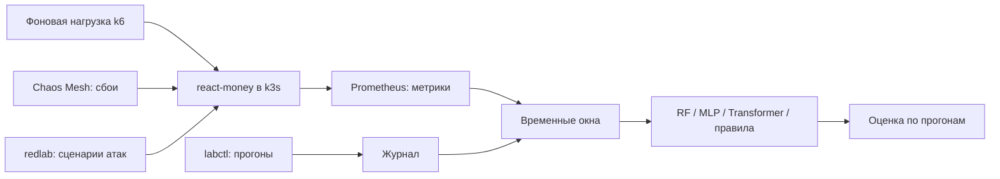

# Проект статьи: атаки и сбои в Kubernetes по метрикам

**Статус: исследовательский черновик; данные и модельные результаты предварительные.** Проверено 13.11.2026. Цель — сравнить RF, MLP и Transformer на задаче «норма / сбой / атака» и исследовать чувствительность к похожим сценариям и к невиданным семействам атак. Проект не доказывает, что метрики сами по себе позволяют установить намерение автора нагрузки.

## Архитектура



Стенд находится на отдельной VPS, исследовательский код — в `research/`. Для атак используется отдельный namespace и NetworkPolicy. Наличие политики не является доказательством действующей изоляции; перед новым запуском требуется проверка исполнения CNI и разрешённых направлений.

## Сценарии исходного сбора

| Класс | Сценарии | Наблюдаемые симптомы |
|---|---|---|
| Норма | базовая нагрузка, flash-crowd | RPS, соединения, нагрузка на БД |
| Сбой | network delay, удаление backend pod, CPU stress, недействительные токены | задержки, готовность, CPU, 401 |
| Атака | brute-force, flood, SQLi-скан, low-brute, pathscan, low-flood | 401, RPS, 4xx/5xx, запросы к БД |

Основные исследуемые пары — `flash-crowd ↔ flood/low-flood` и `authfail ↔ brute/low-brute`. Важно: исходный флуд обращается к `/health`, а штатная нагрузка — к API с БД, поэтому по сочетаниям `pg_tps` и RPS модель может выучить сценарий, а не причину инцидента. Похожий 5xx-сбой для SQLi не был подтверждён.

## Состояние набора и аудита

Сохранены данные 119 из 120 запланированных прогонов: 4243 окна, 21 метрика, 105 агрегатов; классы 2232/948/1063. Один SQLi-прогон остановился до запуска из-за отсутствия фонового трафика. Исходный Prometheus TSDB сохраняет данные только 48 часов, сентябрьские исходные ряды и timestamps последовательностей недоступны.

Проверки обнаружили 1865 окон с предполагаемым выходом 180-секундного контекста за baseline, 300 окон восстановления с автоматической меткой `norm`, 252 окна разового pod-kill с неподтверждённой длительностью воздействия и пропуски четырёх серий. Инъекция и успешность работы сценария независимо не подтверждены по каждому прогону. Детали, хеши и воспроизведение: [AUDIT_2026-11-13.md](AUDIT_2026-11-13.md), [audit_evidence.py](ml/audit_evidence.py).

Исследовательская фильтрация исключает неподтверждённое восстановление, pod-kill и неполную 180-секундную историю. Получено 1556 окон: 372 нормы, 509 сбоев, 675 атак. Для этой первичной таблицы минутный lookback некоторых метрик `rate()` не учитывался, поэтому часть значений могла использовать данные до baseline. Строгая фильтрация с дополнительной минутой сохраняет 913 окон, но полностью исключает историческую пару authfail. Сохранённые 18 отсчётов каждой метрики использованы одинаково у всех моделей: RF/MLP получают агрегаты тех же отсчётов, Transformer — сами последовательности и маску пропусков. Точная причинность и непрерывность отсчётов не доказана без timestamps.

## Оценивание

Пять разделений по прогонам, три seed и вложенные доли 50/75/100% обучающих прогонов; дополнительно отложен временной тест. Валидационные прогоны независимы от train и test; preprocessing обучается только на train. Простой baseline — дерево глубины 2 по RPS, доле ошибок и TPS БД. Метрики включают Macro-F1, precision/recall/F1 каждого класса, матрицу, `fault→attack`, `norm→attack`, `attack→fault`; предсказания и состав разбиений сохраняются. Невиданная атака проверяется на уровне сценария и целого семейства.

Исходные результаты прежнего M4 не являются итоговыми: модели получали разную историю, а MLP использовал случайную внутреннюю валидацию окон. Расстояние до ближайшего соседа не доказывает отсутствие утечки. Новый анализ — исследовательский, поскольку первичные события и timestamps недоступны. В настоящем наборе при исключении семейства flood RF распознал как атаку 0 из 264 тестовых окон, а при исключении семейства brute — около 0.498 от 257 окон; повторные окна и разбиения зависимы.

## Воспроизведение

1. В отдельном Python-окружении установить версии из [`ml/requirements-lock.txt`](ml/requirements-lock.txt).
2. Поместить сохранённые `dataset.csv`, `windows.csv`, `journal.jsonl`, `run.log` в игнорируемый `research/evidence/legacy/`, сверить SHA-256 из [`ml/audit_evidence.json`](ml/audit_evidence.json).
3. Из корня репозитория выполнить `python research/ml/audit_evidence.py`. Для воспроизведения опубликованной предварительной таблицы из 1556 окон: `python research/ml/prepare_audited.py --lookback 0 --out research/evidence/prepared`. Более строгая выборка с 60-секундным запасом `rate()` создаётся командой `python research/ml/prepare_audited.py` в `evidence/prepared-strict/`; это другая выборка, ранее опубликованные метрики для неё не рассчитаны.
4. Запустить `python research/ml/experiment_audited.py`, `python research/ml/generalization_audited.py`, затем `python research/ml/summarize_audited.py` и `python research/ml/report_audited.py`. Для проверки протокола, экспорта и результатов: из `research/ml` выполнить `python -m unittest test_protocol test_export test_matched_control test_matched_summary test_saved_results test_auth_pair test_verified test_verified_results test_fallback -v`.

Крупные исходные файлы не входят в Git. Локальное сохранение не гарантирует долговременный архив — перед удалением/переустановкой ПК требуется отдельная копия с проверкой хешей. Результаты сохраняются в `ml/audited_results/`, предсказания содержат ID прогонов и разметку, но не токены.

## Материалы

- [Черновик статьи](ARTICLE_DRAFT.md)
- [Предварительные результаты по единому контексту](ml/AUDITED_RESULTS.md)
- [Чувствительность к временному запасу rate()](ml/STRICT_RESULTS.md)
- [Аудит и ограничения](AUDIT_2026-11-13.md)
- [Источники](LITERATURE.md)
- [Прежние результаты — устаревшие](ml/RESULTS.md)
- [Машинная сводка аудита и хеши](ml/audit_evidence.json)

Для окончательных выводов нужны новые прогоны с метками фактических событий и исходными timestamped рядами, а также проверка пар на одинаковых endpoint и перекрывающихся интенсивностях. Новизну следует уточнять обзором литературы, а применимость — тестированием на других приложениях и окружениях.

### Дополнительный контроль одного endpoint

`matched_control.py` запускает в `redlab` два синтетических профиля к одному `/api/auth/me`: постоянный поток 120 запросов/с и плавно меняющуюся интенсивность 60–180 запросов/с с той же средней интенсивностью. Оба используют один и тот же тестовый пользовательский контекст, имеют лимиты ресурсов и срок жизни Job. Перед запуском проверяются секреты, наличие NetworkPolicy, доступность Prometheus и один пробный egress-тест; результат последнего не доказывает полную изоляцию от всех внешних адресов. По завершении каждого Job сохраняются статус, timestamps, идентификатор образа, краткий лог k6 и исходные ряды Prometheus с timestamp; временный тестовый токен удаляется.

Опция `--recovery-s 60` дополнительно записывает состояние через минуту после завершения нагрузки: RPS, 5xx, число готовых backend, доступность БД и экспортеров. Проверка сравнивает готовность backend с исходной, но не подтверждает полное восстановление состояния приложения или завершение работы HPA.

Эти профили являются **контрольными нагрузками**, а не самостоятельно подтверждёнными примерами вредоносной атаки или легитимного наплыва. Контроль помогает оценить влияние endpoint и формы нагрузки, но не доказывает распознавание намерения. Сырые артефакты хранятся в игнорируемом `evidence/matched-control/`.

Серия 13.11.2026 завершилась успешно: два flat и два burst Job, приложение после очистки доступно. RF, переобученный на всей исторической выборке без фильтра по lookback PromQL, выдал для двух burst-прогонов 12/12 перекрывающихся окон как «атака»; для двух flat — 8 окон «норма» и 4 «сбой». Анализируются последние 60 секунд после 180-секундной истории и 60-секундного запаса `rate()`. Это всего четыре синтетических прогона в новых условиях, собранных спустя шесть недель; результат не оценивает реальную частоту ложных тревог. Исходные ряды и хеши записаны отдельно, `ml/audited_results/matched_manifest.json`; сводка и график — `matched_control_summary.json` и `matched_control.png` рядом. Для воспроизведения локального анализа: `python research/ml/summarize_matched.py` после размещения исходных JSON в `research/evidence/matched-control/`.

У первых двух burst-прогонов `matched-ramp60s-v1` анализируемый финальный интервал охватывает преимущественно верхнюю часть ramp, поэтому совпадение средней интенсивности за все 300 секунд не означает совпадения в этих окнах. В следующих трёх повторах каждого профиля использовался `matched-ramp30s-v2` с циклами по 30 секунд; версия и SHA-256 сценария записаны в новые артефакты. В этих трёх burst-прогонах медианный RPS анализируемых окон составил 120, как и у flat; исторический RF назначил «атаку» 12 из 18 окон burst. У трёх flat — 12 окон «норма», 6 «сбой» и ни одного «атака». Окна перекрываются; серии v1 и v2 нельзя считать точными повторами друг друга.

Для дополнительной пары 401 подготовлен `auth_pair.py`: оба сценария отправляют на один `/api/auth/login` по 10 запросов/с к синтетическому адресу `.invalid`; «сбой» повторяет неверный пароль, «перебор» меняет пароль фиксированной длины. Это имитации, а не попытка доступа к действующим учётным записям. Job считается успешным только при ожидаемых ответах 401 и выполнении ограничений k6. Времена, статусы и исходные ряды сохраняются отдельно в `evidence/auth-pair/`. `ml/prepare_verified.py` подготавливает timestamped окна из успешно завершившихся контрольных прогонов; такой небольшой набор не заменяет исходный датасет и не описывает реальные частоты атак.

Дополнительная серия завершена: по пять прогонов для каждого из четырёх сценариев, 120 окон (норма 60, сбой 30, имитация перебора 30). Все 20 сырых файлов сверены со стендом по SHA-256; список хешей — [`ml/verified_source_manifest.json`](ml/verified_source_manifest.json). В пяти групповых разбиениях на полном train получены Macro-F1: RF 0.491 ± 0.090, MLP 0.500 ± 0.171, Transformer 0.543 ± 0.017, правила 0.556 ± 0.000. Подробности, ошибки пары и ограничения — в [`ml/VERIFIED_RESULTS.md`](ml/VERIFIED_RESULTS.md). Это отдельный маленький контроль, а не замена историческому набору.

Для проверки отсутствующих рядов отдельно сохранены 20 файлов с запросами без `or on() vector(0)` и `up` экспортеров, также сверенных со стендом по SHA-256. На 120 контрольных точках каждый из четырёх проверенных источников отдавал `up=1`; в 24 точках ноль серии 401/403 был подставлен при отсутствии исходной серии. Это может означать отсутствие запросов с такими кодами, а не сбой сбора. `up=1` не гарантирует наличие каждой метрики. Результаты — `ml/verified_results/fallback_coverage.json`; исходные дополнительные JSON находятся в игнорируемом `evidence/fallback-audit/`.

Для воспроизведения этой серии поместить 10 JSON из `~/react-money/research/evidence/auth-pair/` стенда в `research/evidence/auth-pair/` и 10 JSON из `~/react-money/research/evidence/matched-control/` в одноимённый каталог под `research/evidence/`; сверить SHA-256 по `ml/verified_source_manifest.json`. Из корня репозитория выполнить:

```text
python research/ml/prepare_verified.py
python research/ml/experiment_audited.py --data research/evidence/verified --out research/ml/verified_results
python research/ml/summarize_audited.py --data research/evidence/verified --out research/ml/verified_results
python research/ml/report_verified.py
```

Для последней команды пересчёта требуется локальное окружение из `ml/requirements-lock.txt`. Прогон моделей создаёт новые значения времени работы; для битовой проверки исходных JSON использовать хеши, а сравнение численных результатов проводить с учётом допустимых различий версий и аппаратной платформы.

Чтобы повторить аудит подстановки нулей, отдельно скопировать JSON из `~/react-money/research/evidence/fallback-audit/` в `research/evidence/fallback-audit/`, затем выполнить `python research/ml/verify_integrity.py` и `python research/ml/summarize_fallback.py`. Хеши контрольных файлов и их исходников перечислены в `ml/verified_results/fallback_coverage.json`; последняя проверка 40 локальных JSON по сохранённым манифестам прошла без расхождений.

На той же машине, с теми же версиями, разбиениями и seed, повторное обучение совпало по всем 5184 предсказаниям четырёх методов; время работы не сравнивалось. Проверка и область её действия записаны в `ml/verified_results/reproducibility.json`. Это локальная проверка повторяемости, а не подтверждение переносимости на другую аппаратуру.
