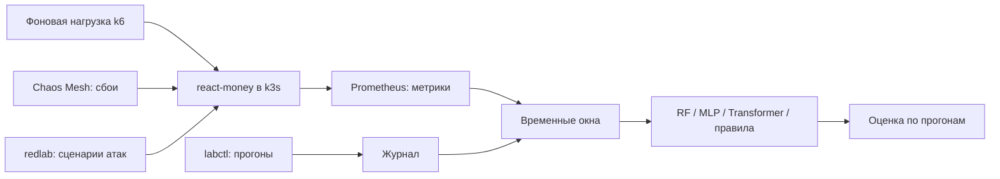

# Проект статьи: атаки и сбои в Kubernetes по метрикам

**Статус: исследовательский черновик; данные и модельные результаты предварительные.** Проверено 13.11.2026. Цель — сравнить RF, MLP и Transformer на задаче «норма / сбой / атака» и исследовать чувствительность к похожим сценариям и к невиданным семействам атак. Проект не доказывает, что метрики сами по себе позволяют установить намерение автора нагрузки.

## Архитектура

Стенд находится на отдельной VPS, исследовательский код — в `research/`. Для атак используется отдельный namespace и NetworkPolicy. Наличие политики не является доказательством действующей изоляции; перед новым запуском требуется проверка исполнения CNI и разрешённых направлений.

## Сценарии исходного сбора

| Класс | Сценарии | Наблюдаемые симптомы |
|---|---|---|
| Норма | базовая нагрузка, flash-crowd | RPS, соединения, нагрузка на БД |
| Сбой | network delay, удаление backend pod, CPU stress, недействительные токены | задержки, готовность, CPU, 401 |
| Атака | brute-force, flood, SQLi-скан, low-brute, pathscan, low-flood | 401, RPS, 4xx/5xx, запросы к БД |

Основные исследуемые пары — `flash-crowd ↔ flood/low-flood` и `authfail ↔ brute/low-brute`. Важно: исходный флуд обращается к `/health`, а штатная нагрузка — к API с БД, поэтому по сочетаниям `pg_tps` и RPS модель может выучить сценарий, а не причину инцидента. Похожий 5xx-сбой для SQLi не был подтверждён.

## Состояние набора и аудита

Сохранены данные 119 из 120 запланированных прогонов: 4243 окна, 21 метрика, 105 агрегатов; классы 2232/948/1063. Один SQLi-прогон остановился до запуска из-за отсутствия фонового трафика. Исходный Prometheus TSDB сохраняет данные только 48 часов, сентябрьские исходные ряды и timestamps последовательностей недоступны.

Проверки обнаружили 1865 окон с предполагаемым выходом 180-секундного контекста за baseline, 300 окон восстановления с автоматической меткой `norm`, 252 окна разового pod-kill с неподтверждённой длительностью воздействия и пропуски четырёх серий. Инъекция и успешность работы сценария независимо не подтверждены по каждому прогону. Детали, хеши и воспроизведение: [AUDIT_2026-11-13.md](AUDIT_2026-11-13.md), [audit_evidence.py](ml/audit_evidence.py).

Исследовательская фильтрация исключает неподтверждённое восстановление, pod-kill и неполную 180-секундную историю. Получено 1556 окон: 372 нормы, 509 сбоев, 675 атак. Сохранённые 18 отсчётов каждой метрики использованы одинаково у всех моделей: RF/MLP получают агрегаты тех же отсчётов, Transformer — сами последовательности и маску пропусков. Точная причинность и непрерывность отсчётов не доказана без timestamps.

## Оценивание

Пять разделений по прогонам, три seed и вложенные доли 50/75/100% обучающих прогонов; дополнительно отложен временной тест. Валидационные прогоны независимы от train и test; preprocessing обучается только на train. Простой baseline — дерево глубины 2 по RPS, доле ошибок и TPS БД. Метрики включают Macro-F1, precision/recall/F1 каждого класса, матрицу, `fault→attack`, `norm→attack`, `attack→fault`; предсказания и состав разбиений сохраняются. Невиданная атака проверяется на уровне сценария и целого семейства.

Исходные результаты прежнего M4 не являются итоговыми: модели получали разную историю, а MLP использовал случайную внутреннюю валидацию окон. Расстояние до ближайшего соседа не доказывает отсутствие утечки. Новый анализ — исследовательский, поскольку первичные события и timestamps недоступны. В настоящем наборе при исключении семейства flood RF распознал как атаку 0 из 264 тестовых окон, а при исключении семейства brute — около 0.498 от 257 окон; повторные окна и разбиения зависимы.

## Воспроизведение

1. В отдельном Python-окружении установить версии из [`ml/requirements-lock.txt`](ml/requirements-lock.txt).
2. Поместить сохранённые `dataset.csv`, `windows.csv`, `journal.jsonl`, `run.log` в игнорируемый `research/evidence/legacy/`, сверить SHA-256 из [`ml/audit_evidence.json`](ml/audit_evidence.json).
3. Из корня репозитория выполнить `python research/ml/audit_evidence.py` и `python research/ml/prepare_audited.py`.
4. Запустить `python research/ml/experiment_audited.py`, `python research/ml/generalization_audited.py`, затем `python research/ml/summarize_audited.py` и `python research/ml/report_audited.py`. Для проверки протокола и экспорта: из `research/ml` выполнить `python -m unittest test_protocol test_export -v`.

Крупные исходные файлы не входят в Git. Локальное сохранение не гарантирует долговременный архив — перед удалением/переустановкой ПК требуется отдельная копия с проверкой хешей. Результаты сохраняются в `ml/audited_results/`, предсказания содержат ID прогонов и разметку, но не токены.

## Материалы

- [Черновик статьи](ARTICLE_DRAFT.md)
- [Предварительные результаты по единому контексту](ml/AUDITED_RESULTS.md)
- [Аудит и ограничения](AUDIT_2026-11-13.md)
- [Источники](LITERATURE.md)
- [Прежние результаты — устаревшие](ml/RESULTS.md)
- [Машинная сводка аудита и хеши](ml/audit_evidence.json)

Для окончательных выводов нужны новые прогоны с метками фактических событий и исходными timestamped рядами, а также проверка пар на одинаковых endpoint и перекрывающихся интенсивностях. Новизну следует уточнять обзором литературы, а применимость — тестированием на других приложениях и окружениях.
