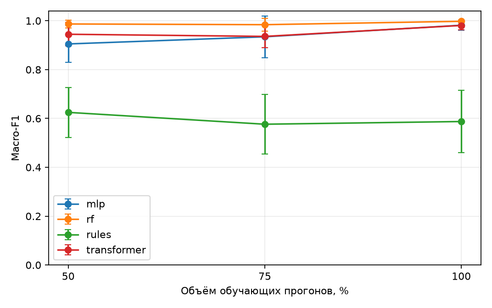
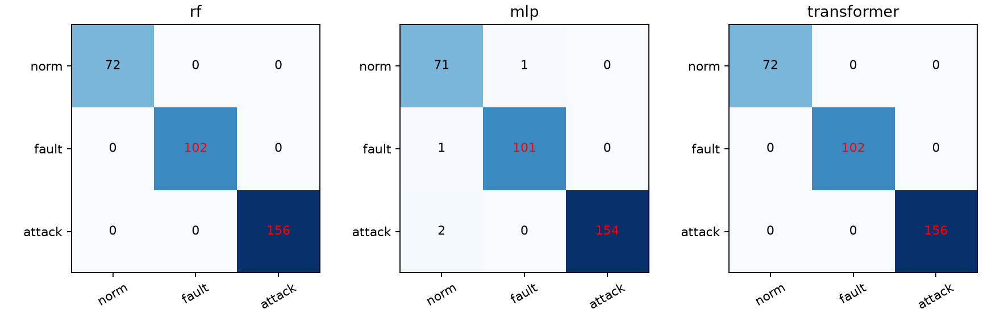

# Предварительные результаты после аудита

> Данные получены из исторического экспорта без времён отдельных отсчётов и без подтверждения инъекции. Результаты характеризуют только отфильтрованную выборку; минутный lookback rate() при этом отборе не учитывался. Для окончательной статьи требуется подтверждённый сбор.

## Основное сравнение

Macro-F1: среднее по трём seed внутри каждого из пяти групповых разбиений, затем среднее ± стандартное отклонение между разбиениями.

| Модель | 50% | 75% | 100% |
|---|---:|---:|---:|
| rules | 0.625 ± 0.102 | 0.576 ± 0.121 | 0.587 ± 0.128 |
| rf | 0.987 ± 0.016 | 0.984 ± 0.026 | 0.998 ± 0.005 |
| mlp | 0.905 ± 0.076 | 0.934 ± 0.086 | 0.982 ± 0.021 |
| transformer | 0.945 ± 0.047 | 0.936 ± 0.045 | 0.981 ± 0.017 |

Размеры выражены в долях **обучающих прогонов** после отделения validation и test. Случайные разбиения могут пересекаться по прогонам, поэтому они не являются независимыми внешними наборами. Временной тест и все значения — в `audited_results/macro_f1_by_split.csv`.

## Ошибки на тестовых окнах

Указаны объединённые доли по 5 разбиениям × 3 seed на 100% train; окна и одни и те же прогоны могут встречаться многократно.

| Модель | norm → attack | fault → attack | attack → fault | recall attack |
|---|---:|---:|---:|---:|
| rules | 0.295 | 0.294 | 0.126 | 0.874 |
| rf | 0.000 | 0.000 | 0.000 | 0.996 |
| mlp | 0.000 | 0.000 | 0.000 | 0.982 |
| transformer | 0.021 | 0.001 | 0.000 | 0.985 |

## Невиданное семейство

RF обучается без указанного семейства, тестируется на его атаках из отложенных прогонов пяти разбиений. Подсчёт по окнам; он не превращает коррелированные окна в независимые наблюдения.

| Исключённое семейство | Окон с повторами между разбиениями | Доля, распознанная как атака |
|---|---:|---:|
| brute_family | 257 | 0.498 |
| flood_family | 264 | 0.000 |

## Абляция метрик для RF

Macro-F1 без отдельных семейств признаков: среднее ± std по пяти групповым разбиениям.

| Исключено | Macro-F1 |
|---|---:|
| none | 0.998 ± 0.005 |
| network | 0.998 ± 0.005 |
| database | 0.996 ± 0.007 |

Состав групп, предсказания и оценки для отдельных сценариев доступны в `audited_results/generalization_predictions.csv.gz`. Абляции сети и БД находятся там же (`kind=ablation`). Ошибки пар — в `pair_errors.csv`. Поля интенсивности и длительности выводятся раздельно в `attack_intensity.csv`; пустая частота означает, что журнал её не сохранил.

## Матрицы ошибок

Один зафиксированный тест: случайное разбиение 0, seed 0, 100% train; строки — истинный класс, столбцы — ответ модели.

Собранные модели отделяют некоторые известные сценарии почти идеально, но endpoint и нагрузка на БД дают короткий путь к ответу. Это не доказывает идентификацию намерения и не гарантирует перенос на реальные инциденты. Доверительные оценки и артефакты обусловлены ограниченным набором прогонов.

Время обучения и инференса для каждой конфигурации сохранено в `metrics.json` (`train_seconds`, `inference_seconds`); значения включают разные шаги подготовки и измерены на текущем CPU. Часть замеров выполнялась параллельно с анализом обобщения; поэтому это диагностические оценки, а не корректный бенчмарк производительности.

Старый 30-секундный vs 180-секундный эксперимент — в [RESULTS.md](RESULTS.md), но его выводы устарели.
