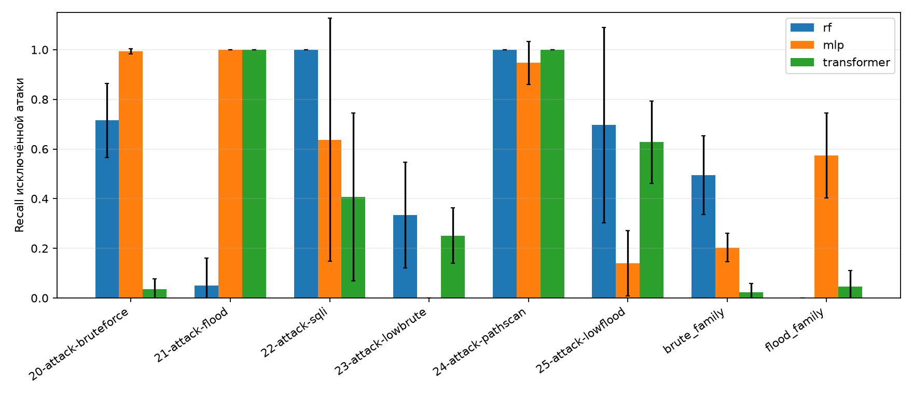

# Исключение сценариев и семейств атак

> Исследовательская оценка на исторических данных: отсутствуют времена отдельных отсчётов и подтверждение инъекции; дополнительный минутный lookback здесь не учитывался. Использовать как ограниченный результат, не как оценку новых реальных атак.

Исключённый сценарий или семейство отсутствует в train и validation. Test включает его атакующие окна и независимые тестовые окна нормальной работы и сбоев. Показаны среднее ± std по пяти групповым разделениям после усреднения трёх seed внутри разделения. Разбиения могут использовать одни и те же прогоны.

| Исключено | Random Forest | MLP | Transformer |
|---|---:|---:|---:|
| 20-attack-bruteforce | 0.715 ± 0.149 | 0.993 ± 0.010 | 0.035 ± 0.042 |
| 21-attack-flood | 0.050 ± 0.112 | 1.000 ± 0.000 | 1.000 ± 0.000 |
| 22-attack-sqli | 1.000 ± 0.000 | 0.637 ± 0.489 | 0.407 ± 0.337 |
| 23-attack-lowbrute | 0.334 ± 0.214 | 0.000 ± 0.000 | 0.251 ± 0.111 |
| 24-attack-pathscan | 1.000 ± 0.000 | 0.947 ± 0.087 | 1.000 ± 0.000 |
| 25-attack-lowflood | 0.696 ± 0.394 | 0.140 ± 0.132 | 0.627 ± 0.166 |
| brute_family | 0.495 ± 0.159 | 0.203 ± 0.057 | 0.024 ± 0.034 |
| flood_family | 0.000 ± 0.000 | 0.574 ± 0.170 | 0.046 ± 0.064 |

Precision класса атаки и доли `fault → attack` и `norm → attack` доступны в `holdout_results/summary.csv`; при отсутствии предсказаний класса атаки precision считается равной нулю. Матрицы, время работы и все предсказания — в `metrics.json` и `predictions.csv.gz`. Обучение только на других синтетических сценариях не гарантирует перенос на произвольные реальные атаки.
