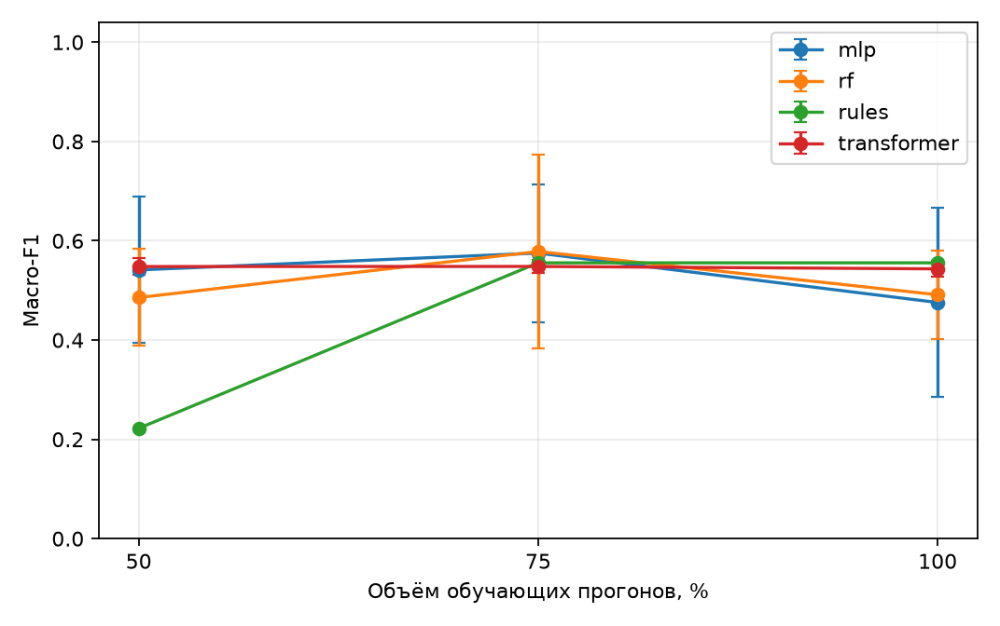
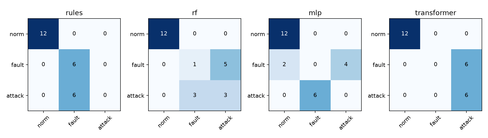
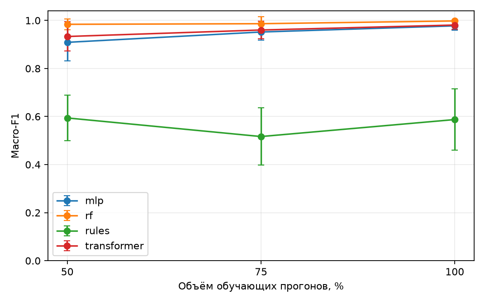
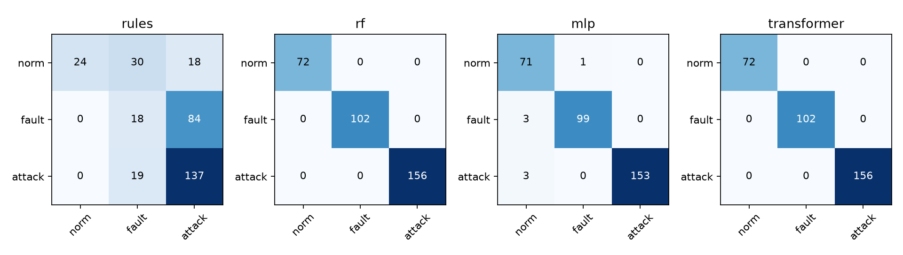

# Сравнение моделей с исправленными долями обучения

Обучающие подвыборки вложены и отбираются по целым прогонам. Для каждой номинальной доли общее число прогонов округляется до ближайшего целого; каждый сценарий представлен хотя бы одним прогоном. На малом проверенном наборе это ровно 6, 9 и 12 из 12 прогонов. Наличие некоторых сценариев только одним прогоном в обучении ограничивает выводы.

MLP выбирает предел итераций из 50, 100 и 150 по независимой групповой validation; Transformer выбирает эпоху по той же группе. Пороговые правила обучаются на train. Показан Macro-F1: среднее ± стандартное отклонение по пяти разделениям после усреднения трёх seed внутри каждого. Окна и повторно используемые прогоны не независимы.

## Малый набор с проверенными интервалами

| Модель | 50% | 75% | 100% |
|---|---:|---:|---:|
| rules | 0.222 ± 0.000 | 0.556 ± 0.000 | 0.556 ± 0.000 |
| rf | 0.486 ± 0.098 | 0.578 ± 0.196 | 0.491 ± 0.090 |
| mlp | 0.541 ± 0.147 | 0.575 ± 0.139 | 0.476 ± 0.190 |
| transformer | 0.548 ± 0.017 | 0.548 ± 0.014 | 0.543 ± 0.017 |

Количество обучающих прогонов по разделениям: `{'0.5': [6, 6], '0.75': [9, 9], '1.0': [12, 12]}`.

Матрицы одного разделения и seed; строки — истинный класс, столбцы — прогноз.

Для пары одинаковых 401 (доли окон, объединённых по разделениям и seed):

| Модель | сбой → атака | атака → сбой |
|---|---:|---:|
| rules | 0.000 | 1.000 |
| rf | 0.689 | 0.667 |
| mlp | 0.778 | 0.722 |
| transformer | 0.667 | 0.333 |

## Исторический исследовательский набор

| Модель | 50% | 75% | 100% |
|---|---:|---:|---:|
| rules | 0.594 ± 0.095 | 0.517 ± 0.119 | 0.587 ± 0.128 |
| rf | 0.984 ± 0.022 | 0.986 ± 0.029 | 0.998 ± 0.005 |
| mlp | 0.909 ± 0.077 | 0.952 ± 0.034 | 0.977 ± 0.018 |
| transformer | 0.933 ± 0.061 | 0.960 ± 0.036 | 0.981 ± 0.017 |

Количество обучающих прогонов по разделениям: `{'0.5': [32, 32], '0.75': [48, 48], '1.0': [64, 64]}`.

Матрицы одного разделения и seed; строки — истинный класс, столбцы — прогноз.

Исторический набор остаётся исследовательским: timestamps исходных отсчётов и подтверждение инъекций отсутствуют, дополнительный lookback `rate()` не учитывался. Малый набор содержит четыре синтетических сценария и один стенд; распределение классов не отражает реальную частоту атак.

Предсказания всех окон, составы разделений и подвыборок, параметры, матрицы и времена сохранены в соответствующих каталогах. Замеры времени выполнялись одновременно с другими задачами и не являются сравнительным бенчмарком. Предыдущие расчёты с округлением отдельно по сценариям сохранены для прослеживаемости и обозначены как номинальные доли.

Для воспроизведения запустить `experiment_audited.py` с `--subset-mode proportional --mlp-selection grouped`, указав `--data` и `--out`, затем выполнить `summarize_audited.py` с теми же путями и `report_proportional.py`.
