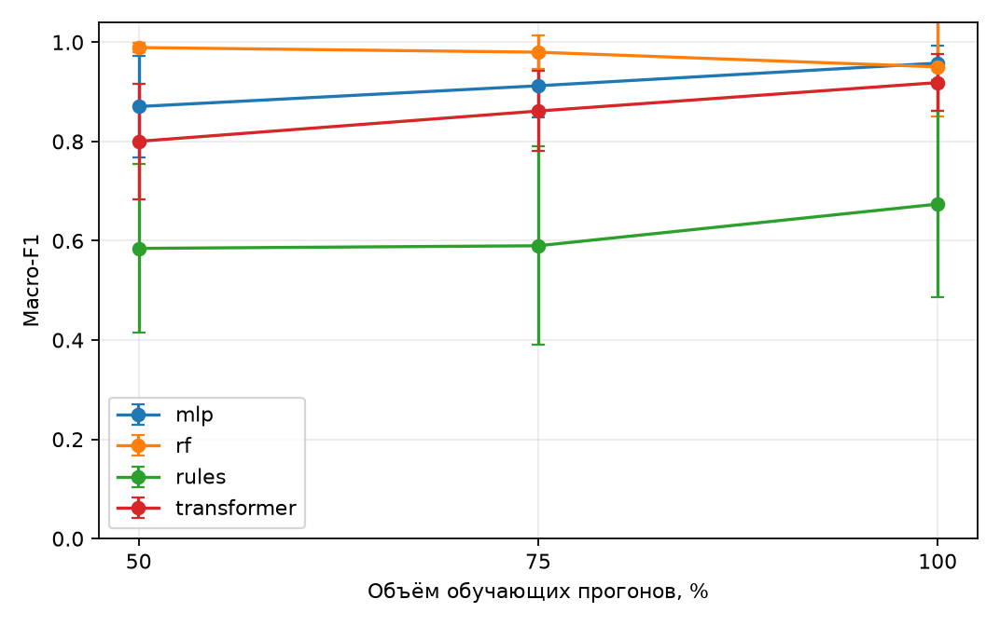

# Проверка чувствительности к lookback Prometheus

В отличие от предварительной таблицы на 1556 окнах, здесь дополнительно учитывается минута предыстории для PromQL `rate(...[1m])`. По границам исходного CSV остаётся 913 окон: 252 нормы, 329 сбоев и 332 атаки. Времён отдельных отсчётов исходный экспорт не содержит, поэтому даже этот вариант не подтверждает точную причинность исходных рядов.

Важное ограничение: исторический сценарий `authfail` полностью исчезает после строгой фильтрации. Поэтому это **не проверка пары 401**, и эти числа нельзя считать непосредственным доказательством решения основной задачи статьи.

## Исправленный протокол

После переноса на Aspire проведён пересчёт: доли округляются по общему числу обучающих прогонов, все сценарии представлены в подвыборках, MLP выбирает предел итераций по независимым validation-прогонам. Данные и ограничения остались прежними. Средний Macro-F1 ± стандартное отклонение по пяти разбиениям после усреднения трёх seed:

| Модель | 50% | 75% | 100% |
|---|---:|---:|---:|
| Пороговые правила | 0.585 ± 0.170 | 0.590 ± 0.200 | 0.674 ± 0.187 |
| Random Forest | 0.989 ± 0.010 | 0.980 ± 0.034 | 0.950 ± 0.101 |
| MLP | 0.870 ± 0.102 | 0.912 ± 0.063 | 0.958 ± 0.035 |
| Transformer | 0.800 ± 0.116 | 0.861 ± 0.081 | 0.919 ± 0.057 |

Составы разделений и подвыборок, параметры, матрицы, предсказания и времена находятся в `strict_proportional/`. Протокол проверен тестом `test_proportional_results.py`: совпадение тестовых окон между моделями, вложенность и размеры подвыборок, выбор MLP по validation. Значения времени не являются бенчмарком производительности: вычисления выполнялись на работающем стенде.

Воспроизведение из корня проекта: `python research/ml/prepare_audited.py`, затем `python research/ml/experiment_audited.py --data research/evidence/prepared-strict --out research/ml/strict_proportional --subset-mode proportional --mlp-selection grouped` и `python research/ml/summarize_audited.py --data research/evidence/prepared-strict --out research/ml/strict_proportional`.

## Предыдущий расчёт

В приведённой ниже таблице MLP использовал фиксированный предел 150 итераций, а доли 50% и 75% округлялись вниз отдельно по сценарию. Фактическое число обучающих прогонов при этих долях может быть меньше указанного. Эта таблица сохранена для прослеживаемости.

Macro-F1, среднее по трём seed внутри разбиения и затем среднее ± стандартное отклонение по пяти групповым разбиениям:

| Модель | 50% | 75% | 100% |
|---|---:|---:|---:|
| Пороговые правила | 0.554 ± 0.160 | 0.598 ± 0.197 | 0.674 ± 0.187 |
| Random Forest | 0.967 ± 0.062 | 0.946 ± 0.072 | 0.950 ± 0.101 |
| MLP | 0.879 ± 0.104 | 0.905 ± 0.098 | 0.968 ± 0.040 |
| Transformer | 0.801 ± 0.120 | 0.838 ± 0.117 | 0.919 ± 0.057 |

Изменились и набор окон, и набор сценариев, поэтому сравнение с 1556 окнами не позволяет приписать разницу исключительно учёту lookback. Внешнего датасета и доказательства переносимости на другие приложения нет.

Исходные настройки, составы прогонов, предсказания и метрики: [`strict_results/`](strict_results/). Воспроизведение: `python research/ml/prepare_audited.py`, затем `python research/ml/experiment_audited.py --data research/evidence/prepared-strict --out research/ml/strict_results`, после чего `python research/ml/summarize_audited.py --data research/evidence/prepared-strict --out research/ml/strict_results`.
