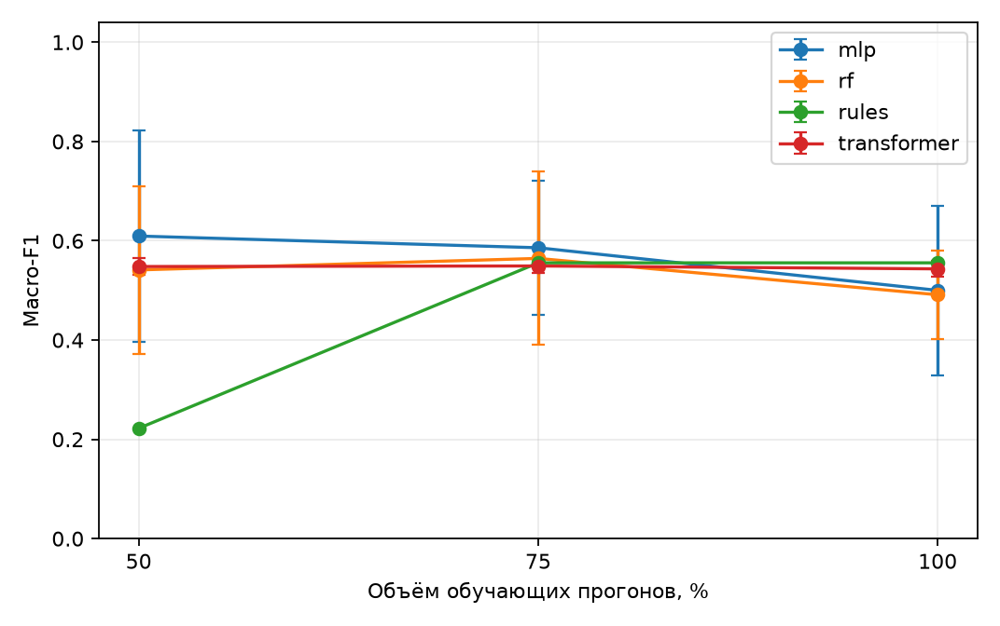
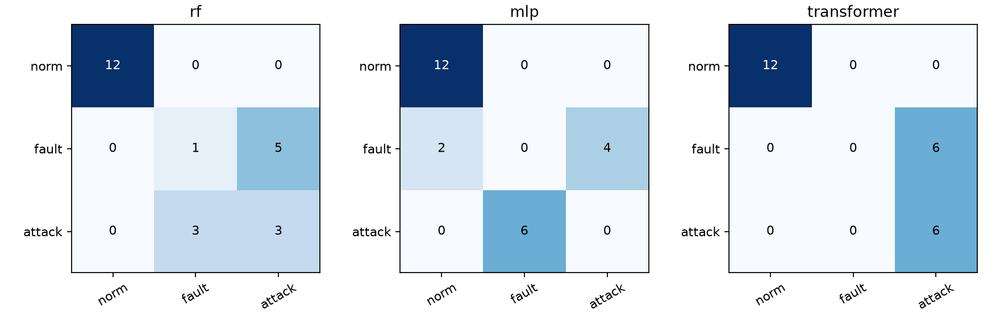

# Дополнительный эксперимент: проверенные интервалы и пара 401

**Это небольшой синтетический контроль на одном стенде.** Классы задаются сценарием, а не устанавливают реальные намерения клиента или переносимость на другие приложения.

Для каждой метрики сохранены временные метки и исходные серии; включены только успешно завершённые Job, прошедшие проверки HTTP-ответов и количества сброшенных итераций. Первые 235 секунд исключены с учётом истории и lookback.

Это timestamps вычисления Prometheus query_range, а не времена исходных scrape отдельных счётчиков. Сохранены результаты PromQL с выражениями, а не полный архив сырых счётчиков; состояние системы может сохраняться от предыдущего прогона.

Дополнительная проверка без подстановки нулей: проверены up для 4 экспортёров; в 24 точках 401/403 равнялся нулю из fallback при отсутствии исходной серии. Это может быть нормальным отсутствием такого кода, а не отказом экспортера. Отдельная диагностика не была добавлена в признаки моделей; их результаты не пересчитывались. Детали — `verified_results/fallback_coverage.json`.

Повторный запуск на той же машине с теми же зависимостями, разбиениями и seed совпал по всем 5184 предсказаниям; время не сравнивалось. Это не доказывает идентичность на другой аппаратуре.

Число окон по классам: `{'norm': 60, 'attack': 30, 'fault': 30}`. Прогонов по сценариям: `{'auth-guessing': 5, 'auth-misconfiguration': 5, 'control-burst': 5, 'control-flat': 5}`.

## Сравнение моделей

Macro-F1, среднее ± std по пяти групповым разбиениям после усреднения трёх seed внутри разбиения.

| Модель | 50% | 75% | 100% |
|---|---:|---:|---:|
| rules | 0.222 ± 0.000 | 0.556 ± 0.000 | 0.556 ± 0.000 |
| rf | 0.541 ± 0.169 | 0.564 ± 0.175 | 0.491 ± 0.090 |
| mlp | 0.610 ± 0.214 | 0.586 ± 0.135 | 0.500 ± 0.171 |
| transformer | 0.548 ± 0.017 | 0.549 ± 0.014 | 0.543 ± 0.017 |

Для RF на одном фиксированном тестовом разбиении групповой bootstrap по `run_id` даёт 95% перцентильный интервал Macro-F1 [0.210; 0.559]. В тесте всего четыре прогона; повторная выборка иногда не содержит все классы, поэтому интервал условен и очень груб.

## Пара одинаковых 401

Оба профиля отправляли 10 запросов/с на один `/api/auth/login` к синтетическому адресу `.invalid`. Профиль ошибки клиента повторял один неверный пароль; профиль имитации перебора менял пароль той же длины. Тела запросов и идентификаторы сценария не входят в признаки моделей.

| Модель | fault → attack | attack → fault | fault → norm | attack → norm |
|---|---:|---:|---:|---:|
| rules | 0.000 | 1.000 | 0.000 | 0.000 |
| rf | 0.689 | 0.667 | 0.000 | 0.000 |
| mlp | 0.833 | 0.589 | 0.022 | 0.000 |
| transformer | 0.667 | 0.333 | 0.000 | 0.000 |

Доли объединяют окна по пяти разбиениям и трём seed; окна перекрываются, прогоны повторяются между разбиениями. Они не являются независимыми наблюдениями и не оценивают частоты инцидентов в эксплуатации. Для части запусков MLP достиг лимита итераций без сходимости. Составы прогонов, предсказания, метрики и времена сохранены в `verified_results/`.

Контрольные профили нормальной нагрузки обращаются к другому endpoint (`/api/auth/me`), поэтому класс нормальной нагрузки всё ещё может иметь shortcut. В одном кластере нельзя установить переносимость на другие приложения и среды. Повторы выполнялись последовательно без подтверждения полного восстановления состояния HPA; эффект временного дрейфа и порядка не исключён.

Два сценария 401 различаются только в содержимом перебираемых паролей; агрегированные метрики могут не содержать информации, необходимой для определения намерения. Результат следует интерпретировать как проверку наблюдаемости на этом стенде.
